  

  
  
  

  

  

I run one agent, [Hermes Agent](https://github.com/NousResearch/hermes-agent), on my desktop, and most of my work goes through it. I give it a one-line spec, it does the work, and it shows me proof before calling anything done.

- **Routing.** Hermes plans and verifies. Heavy Kotlin and Swift work goes to Claude Code, and bulk or background jobs go to DeepSeek V4.1 Flash. Research and translation fan out to parallel subagents.
- **Memory and skills.** Long-term memory lives in [Hindsight](https://github.com/vectorize-io/hindsight). Every workflow I repeat becomes a skill: Play releases, PR review, Resolve automation, even this README. The second run is faster than the first.
- **Apps.** On Vanoa, agents review my teammate's pull requests. They build the debug APK, run it on an emulator, read logcat, post the evidence on the PR, and merge only what passes.
- **Video.** Agents drive DaVinci Resolve Studio through its Python API. They smart-insert voiceovers, bake music beds with ducking, place SFX, and build Arabic titles that are checked against HarfBuzz shaping. They also turn Arabic audio into English subtitles.
- **Schedules.** Cron jobs open my usage windows, check backups and write a daily digest of the Hermes ecosystem.
- **Guardrails.** Anything that posts, spends, deletes or ships waits for my yes. "Done" means a build, test or render actually ran.

Tools I built along the way: [hermes-quota-gauge](https://github.com/cynricantao/hermes-quota-gauge) (live quota bars for AI subscriptions inside Hermes Desktop), [omarchy-ai-usage](https://github.com/cynricantao/omarchy-ai-usage) and [omarchy-token-activity](https://github.com/cynricantao/omarchy-token-activity) (local token history on the desktop bar).

<b>MOBILE & FRONTEND</b> 
   
  
  
  
  

<b>BACKEND</b> 
   
  

<b>DEVOPS & TOOLS</b> 
   
  
  
  

  

  

  <picture>
    <source media="(prefers-color-scheme: dark)" srcset="https://raw.githubusercontent.com/cynricantao/cynricantao/output/github-snake-dark.svg" />
    <source media="(prefers-color-scheme: light)" srcset="https://raw.githubusercontent.com/cynricantao/cynricantao/output/github-snake.svg" />
    
  </picture>

  

  
  
  

  

<!-- Static panels: tools/build_svgs.py. Live stats + snake: .github/workflows/snake.yml (every 12h, output branch). -->
